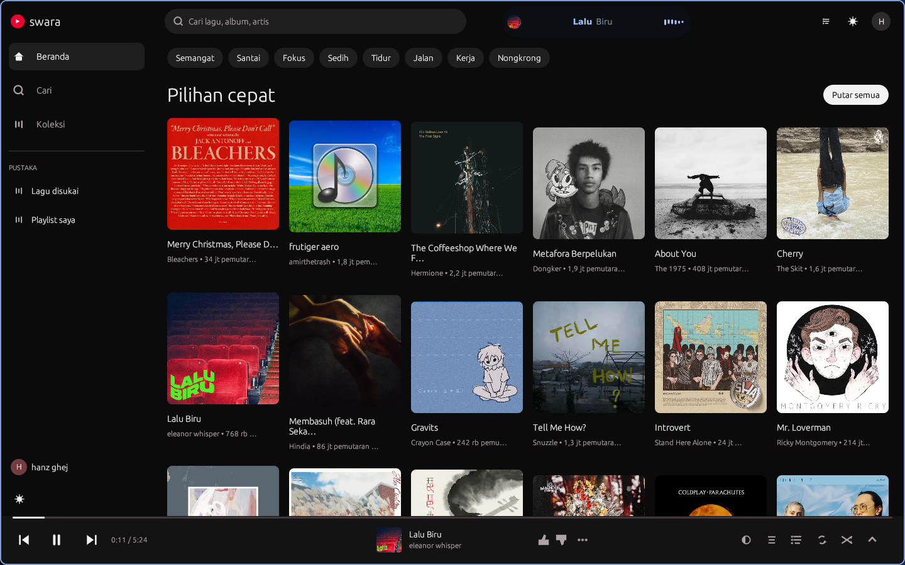
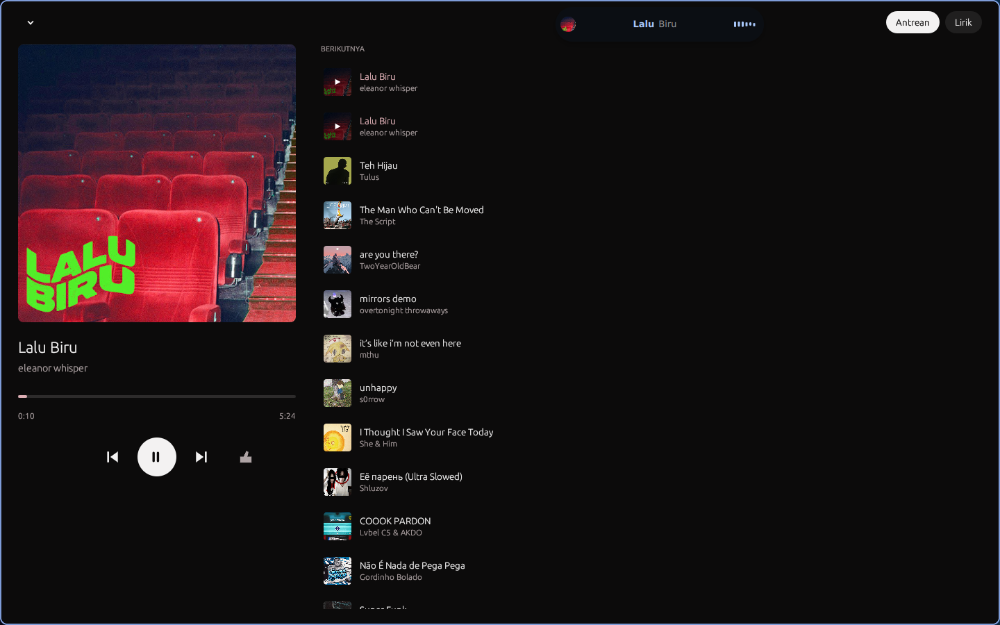
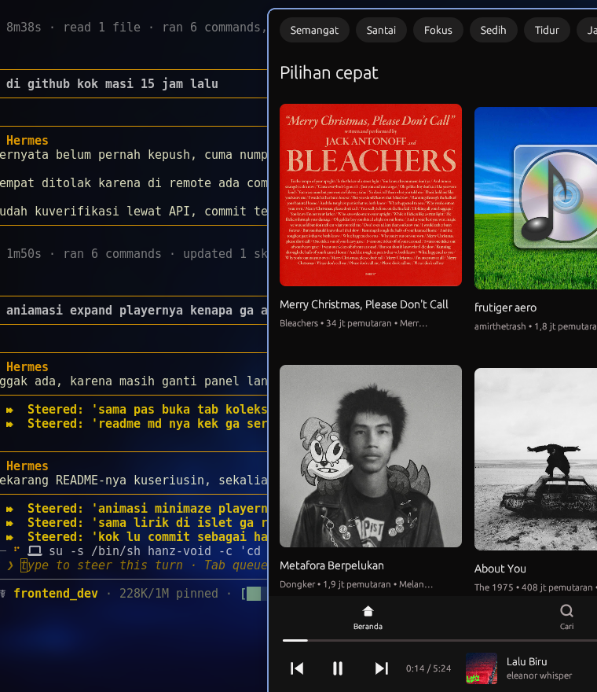

# Swara

Pemutar musik desktop untuk YouTube Music, ditulis utuh dalam Rust. Tanpa
Chromium, tanpa webview, tanpa server lokal: satu binary yang membuka jendelanya
sendiri, mengambil audionya sendiri, dan mendekodenya sendiri.

> **Tidak perlu login Google di Swara.** Tidak ada kolom kata sandi dan tidak ada
> halaman login. Kalau kamu sudah login YouTube di Chromium di mesin yang sama,
> Swara membaca cookie-nya sekali dari profil browser itu, lalu menyimpannya di
> berkas cache milikmu sendiri (`auth.json`, bisa dihapus kapan saja lewat tombol
> keluar). Tanpa sesi pun Swara tetap bisa mencari dan memutar musik; yang hilang
> hanya playlist akun dan tombol suka.



Antarmuka mengikuti tata letak YouTube Music: rail navigasi di kiri, kolom cari di
atas, kartu sampul berradius kecil, dan pemutar tiga zona di bawah. Warna diambil
dari sampul lagu yang sedang diputar, jadi tiap lagu membawa suasana sendiri.

| Pemutar penuh | Jendela sempit |
|---|---|
|  |  |

## Isi

- **Beranda** dari feed YouTube Music: pilihan cepat, mix lagu, tangga lagu,
  rilisan baru, suasana & genre.
- **Pencarian** dengan saran saat mengetik.
- **Koleksi**: playlist akun dan lagu yang disukai, dibaca dari sesi Chromium
  yang sudah ada di mesin ini. Tanpa kata sandi, tanpa halaman login.
- **Pemutar** penuh: seek, transport, antrean dari mix `RDAMVM`, putar semua dari
  album atau playlist.
- **Antrean & lirik** dalam panel kanan, plus pemutar penuh yang naik dari bawah
  dengan animasi.
- **Lirik sinkron** dari [LRCLIB](https://lrclib.net), baris aktif tersorot dan
  panel menggulir sendiri.
- **MPRIS** dua arah: islet/quickshell bisa membaca judul, posisi, dan lirik, dan
  bisa mengirim play/pause/next/seek balik ke Swara.
- **Impor sesi** lewat `swara --login` (membaca cookie Chromium, bukan mengetik
  kata sandi).

## Unduh

Rilis siap pakai untuk Linux (x86_64), Windows (x86_64), dan macOS (Apple
Silicon maupun Intel) ada di halaman [Releases](https://github.com/hanxthvy/swara/releases).
Ekstrak, lalu jalankan `swara`. Di macOS, binary belum ditandatangani, jadi
pertama kali jalankan `xattr -dr com.apple.quarantine swara`.

## Bangun sendiri

Butuh Rust 1.80+. Di Linux tambahan `pkg-config` dan header `alsa-lib`; di
Windows dan macOS tidak ada dependensi sistem tambahan.

```sh
cargo build --release
# Linux/macOS
install -Dm755 target/release/swara ~/.local/bin/swara
```

Build untuk sistem lain dijalankan otomatis oleh GitHub Actions
(`.github/workflows/build.yml`): empat target, satu job rilis saat tag `v*`
dipush, lengkap dengan berkas `.sha256`.

Pertama kali dijalankan, Swara mengambil kredensial InnerTube dari halaman
YouTube Music dan menyimpannya 24 jam di cache milik sistem
(`~/.cache/swara` di Linux, `~/Library/Caches/swara` di macOS,
`%LOCALAPPDATA%\swara` di Windows).

### Menyambungkan akun (opsional, tanpa kata sandi)

Swara tidak punya form login. Yang dipakai adalah sesi YouTube yang sudah ada di
profil Chromium/Chrome/Brave/Edge/Vivaldi di mesin itu:

1. Buka `youtube.com` di Chromium dan pastikan sudah login.
2. Tutup Chromium (Supaya berkas cookie-nya tidak terkunci; kalau masih terbuka,
   Swara menyalinnya dulu ke berkas sementara).
3. Jalankan `swara --login`, atau klik tombol akun di pojok kanan atas aplikasi.

Tidak ada kata sandi yang diketik di Swara, dan tidak ada yang dikirim ke mana
pun selain ke YouTube sendiri. Impor sesi saat ini baru bisa membaca cookie
Chromium di Linux; di Windows dan macOS Swara tetap mencari dan memutar, hanya
fitur akun belum aktif.

## Pintasan

| Tombol | Fungsi |
|---|---|
| `Spasi` | putar / jeda |
| `←` `→` | mundur / maju 5 detik |
| `n` `p` | lagu berikutnya / sebelumnya |
| `f` | buka pemutar penuh |
| `Esc` | tutup pemutar penuh |

Semua pintasan huruf mati saat kursor ada di kolom cari, jadi mengetik "faded"
tidak akan membalik layar.

## Alat uji

Binary yang sama bisa dipakai tanpa jendela:

```sh
swara --probe "tulus monokrom"   # waktu tiap tahap: cari, stream, unduh, decode
swara --lib                      # kartu pustaka
swara --isi <browseId> [n]       # isi playlist/album
swara --suka [n]                 # lagu yang disukai
swara --cepat <videoId>          # ukur TTFB dan laju unduh per klien
```

Variabel lingkungan: `SWARA_PLAY=<videoId>` memutar satu lagu tanpa pencarian,
`SWARA_LIST=<browseId>` memutar playlist utuh, `SWARA_SEEK=<detik>` menguji seek,
`SWARA_EXPAND=1` membuka pemutar penuh, `SWARA_TICK_DEBUG=1` mencatat posisi.

## Cara kerjanya

Metadata lewat klien InnerTube **WEB_REMIX** (`music.youtube.com/youtubei/v1`):
`search`, `browse`, `next`, `music/get_search_suggestions`. Kredensial
(`INNERTUBE_API_KEY`, versi klien, `visitorData`) diambil sekali dari halaman
utama dan disimpan 24 jam.

Stream lewat klien **VISIONOS** (client id 101, `v1.02`) — satu-satunya klien yang
masih mengembalikan URL audio langsung tanpa `signatureCipher` dan tanpa
transformasi `n`. Kuncinya `visitorData`: tanpa itu VISIONOS menjawab
`LOGIN_REQUIRED`. Klien lain sudah diukur dan gagal (ANDROID_VR → login,
WEB → SABR tanpa url, TVHTML5 → error).

Audio diunduh bertahap dengan `Range: bytes=0-` (tanpa Range, googlevideo menahan
laju ke ~40 KB/s lalu menggantung), didekode AAC-nya dengan `symphonia` sambil
mengalir, lalu dikirim ke `rodio` sebagai `Source<Item = f32>`. Lagu berikutnya
disiapkan di latar, jadi pindah lagu terasa 0,6 detik dan bunyi pertama ~2,5 detik.

Posisi diambil dari sampel yang benar-benar keluar dari sink (`sink.get_pos()`),
bukan jam dinding, supaya lirik tidak mendahului saat unduhan tersendat. Pembaca
MPRIS seperti quickshell hanya menyegarkan cache posisi saat menerima sinyal
`Seeked`, jadi Swara memancarkannya tiap 5 detik dan setiap posisi melompat.

Semua yang berjalan periodik — konduktor antrean, jembatan MPRIS — berada di
thread sendiri, bukan di `update()` egui. Di Wayland, jendela yang pindah
workspace berhenti menerima frame callback, jadi logika di `update()` akan mati
total saat jendelanya disembunyikan.

## Struktur

| berkas | isi |
|---|---|
| `src/api.rs` | klien InnerTube: kredensial, cari, beranda, browse, stream, radio |
| `src/auth.rs` | impor cookie Chromium → `SAPISIDHASH` |
| `src/player.rs` | dekoder AAC + rodio, seek berbasis sampel, volume |
| `src/stream.rs` | buffer audio yang tumbuh saat diunduh (`Condvar`) |
| `src/conductor.rs` | antrean dan lanjut otomatis, di luar UI |
| `src/bridge.rs` | jembatan MPRIS dua arah |
| `src/mpris.rs` | server MPRIS, metadata, posisi |
| `src/worker.rs` | thread HTTP supaya UI tidak membeku |
| `src/ui.rs` | seluruh antarmuka egui |
| `src/theme.rs` | token warna dan ukuran |
| `src/cepat.rs` | alat ukur klien InnerTube |
| `src/main.rs` | entry point, argumen, `--probe` |

## Batasan

- Butuh internet, jelas.
- Bergantung pada klien VISIONOS. Kalau YouTube menutupnya, ganti klien di
  `api.rs` — `swara --cepat` bisa dipakai untuk mengukur mana yang masih jalan.
- LRCLIB hanya memberi waktu per baris; sorotan per kata dihitung dari panjang
  kata, jadi pada lagu dengan pelafalan tidak rata bisa meleset satu-dua kata.
- Impor akun hanya lewat profil Chromium di mesin yang sama, dan baru bisa
  membaca cookie di Linux. Di Windows dan macOS Swara tetap mencari dan
  memutar, hanya fitur akun belum aktif.
- MPRIS hanya ada di Linux. Di Windows dan macOS belum ada integrasi panel
  sistem (SMTC/Now Playing).

## Lisensi

MIT. Tidak berafiliasi dengan YouTube atau Google.
